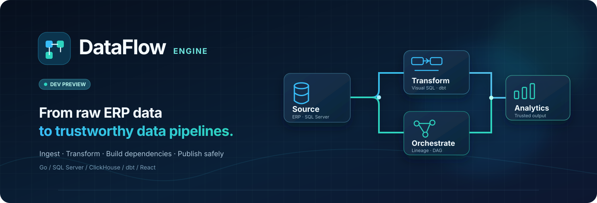
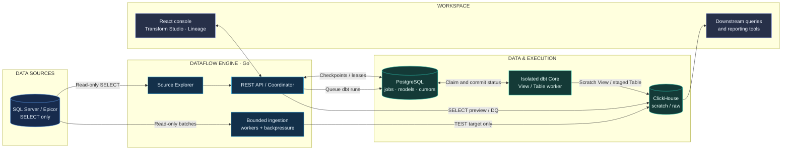
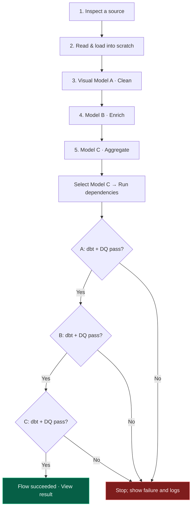
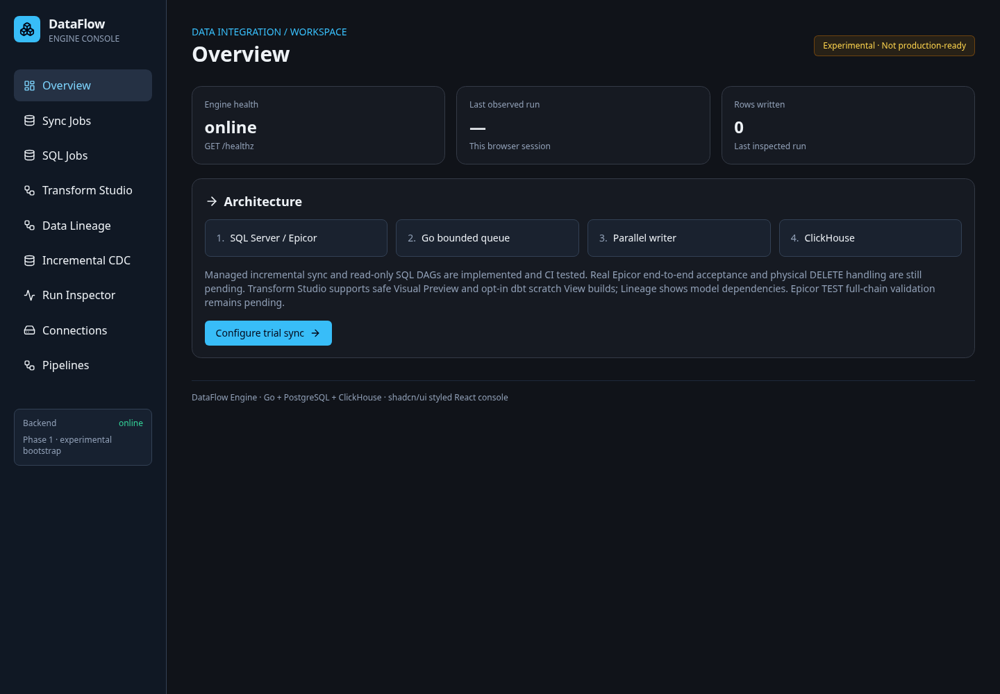
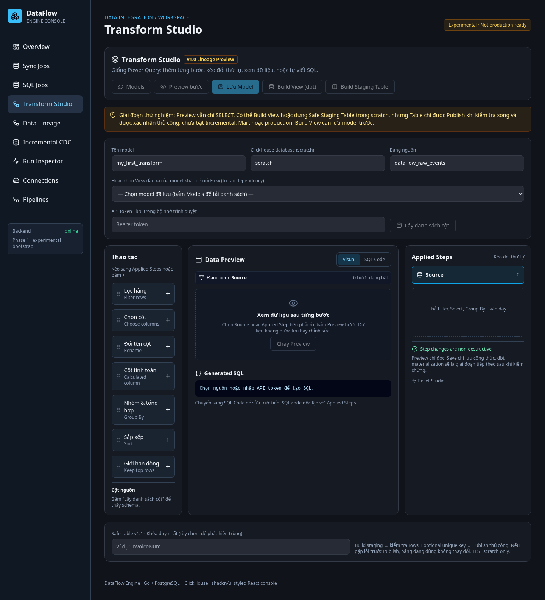
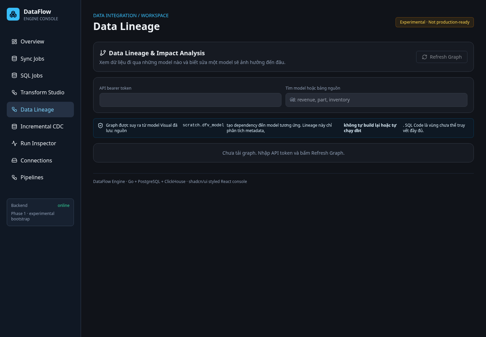
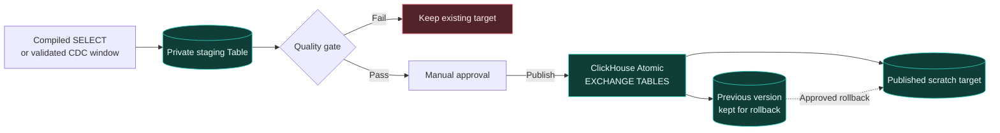

<div align="center">



# DataFlow Engine

**A visual, developer-focused data integration workbench**  
**Ingest → Transform → Orchestrate → Validate → Publish**

*Go-powered data movement · ClickHouse analytics · dbt transformations · PostgreSQL-backed reliability*

[](https://github.com/dinhvansh/dataflow-engine/actions/workflows/ci.yml)


[**Architecture**](#architecture) ·
[**Features & boundaries**](#what-is-implemented) ·
[**Screenshots**](#console-gallery--synthetic-qa-snapshots) ·
[**Local QA**](#run-the-local-qa-suite) ·
[**Get started**](#get-started) ·
[**Roadmap**](#roadmap)

</div>

> [!IMPORTANT]
> **Developer preview · Not production-ready.** Go/React/PostgreSQL/ClickHouse/dbt code and synthetic integration paths are covered by GitHub CI. V3.2B/V3.2C/V3.3 and V4 foundations are **partially implemented in disconnected or synthetic test code**, not automatically available in the live console. **Real Epicor source acceptance, production IdP/Vault provisioning, driver-level Test Connection, unified pipeline execution, local E2E and 7M+ throughput benchmarks remain unverified.** Source ERP is strictly **SELECT-only**; writes target only explicitly approved disposable scratch fixtures.

---

## Latest development status · 18 October 2026

DataFlow has progressed beyond the **v1.3 shipped preview** into independently tested security, connection-management, orchestration and Data Quality foundations. The statuses below deliberately distinguish **code delivered** from **a live, user-operable feature**.

| Workstream | Verified implementation | What is **not** yet live |
|:---|:---|:---|
| **V3.2B · Security** | Scoped grants, append-only audit and rotation journal; pinned RS256 verifier; optional HashiCorp KV-v2 adapter; default-off TLS 1.3 lab listener and JWT metadata GET. [#57](https://github.com/dinhvansh/dataflow-engine/pull/57) · [#58](https://github.com/dinhvansh/dataflow-engine/pull/58) · [#59](https://github.com/dinhvansh/dataflow-engine/pull/59) · [#61](https://github.com/dinhvansh/dataflow-engine/pull/61) · [#63](https://github.com/dinhvansh/dataflow-engine/pull/63) · [#64](https://github.com/dinhvansh/dataflow-engine/pull/64) · [#65](https://github.com/dinhvansh/dataflow-engine/pull/65) | Production SSO / JWKS life cycle, real Vault secret provisioning, credential write API and audited recovery operations. |
| **V3.2C · Test Connection safety** | Offline DNS/CIDR/host/port admission with IP pinning and bounded synthetic TCP probe. [#67](https://github.com/dinhvansh/dataflow-engine/pull/67) · [#71](https://github.com/dinhvansh/dataflow-engine/pull/71) | Real SQL Server/ClickHouse driver authentication, network egress approval and scoped TEST endpoint. |
| **V3.3 · Connection bindings** | Immutable *non-executable* pipeline-node/connection UUID + revision snapshots and tenant isolation in PostgreSQL. [#70](https://github.com/dinhvansh/dataflow-engine/pull/70) | ACTIVE connection lifecycle and execution-time job binding. |
| **V4.0 · Unified pipelines** | Synthetic typed SOURCE → SYNC → TRANSFORM → QUALITY → PUBLISH DAG with snapshot/failure/cancellation tests. [#68](https://github.com/dinhvansh/dataflow-engine/pull/68) | Persistent mixed-step worker, live source/destination adapters or execution from the canvas. |
| **V4.1 · Data Quality** | Six fail-closed metric/schema contract checks and synthetic proof that failed QUALITY blocks PUBLISH. [#69](https://github.com/dinhvansh/dataflow-engine/pull/69) | Real read-only metric extraction, persisted evidence and publication gate/rollback. |
| **V4.2 · Efficient incremental** | The earlier v1.3 safe copy-on-write staging implementation remains available for TEST. | Efficient 7M+ row incremental pipeline, native physical deletes, throughput/latency benchmark against Airbyte. |

**Canonical source of truth:** [Project handoff](docs/PROJECT_HANDOFF_LATEST.md) · [Master roadmap and status](docs/MASTER_ROADMAP_AND_STATUS.md) · [GitHub Actions CI](https://github.com/dinhvansh/dataflow-engine/actions). CI PASS is **synthetic evidence**, not a production security certification or permission to run against a real ERP.

## Why DataFlow?

Business data pipelines are often spread between an ingestion tool, SQL scripts, transformation jobs and separate reporting tools. DataFlow brings the **development workflow and operational state** into one place while keeping its execution responsibilities explicit.

| Discover & ingest | Transform visually | Run with dependencies |
|:---|:---|:---|
| Inspect SQL Server metadata and experiment with bounded, read-only extraction into ClickHouse. | Build a sequence of visual transformations, preview each step and inspect the generated SQL. | See which model depends on which source; select the final model and run an upstream-first View chain. |

| Publish carefully | Recover from failures | Investigate problems |
|:---|:---|:---|
| Stage a physical ClickHouse Table, verify it, then explicitly approve publication and rollback. | PostgreSQL-backed queues, leases, fencing and run snapshots reduce restart and retry hazards. | Follow run history, model-level statuses, error messages, lineage and affected descendants. |

**In Vietnamese:** DataFlow hướng tới trải nghiệm *đồng bộ dữ liệu → kéo-thả xử lý như Power Query → dùng dbt build → theo dõi pipeline → kiểm tra trước khi publish*, trên một giao diện thống nhất. Mục tiêu là dễ kiểm soát và dễ kiểm chứng, **không** phải tuyên bố đã thay thế hoàn toàn Airbyte/dbt/n8n.

## Architecture



**Separation of responsibilities:** Go handles API, ingestion and durable scheduling; PostgreSQL persists state; ClickHouse stores/query data; an isolated **dbt Core** process materializes saved visual SELECT models; React presents operations and diagnostics.

The SQL Server connection remains **strictly read-only**. DataFlow must never perform DML/DDL on Epicor.

## From a raw source to a built model



**What this flow means today:** v1.2 runs **single-source Visual models materialized as ClickHouse Views** in dependency order, one at a time. It validates nonempty output and a TEST row cap **after** each View build. It does **not** atomically hide the Views from other readers before DQ, roll back the whole chain, or automatically publish Tables.

## What is implemented?

| Module | Capabilities available in code | Boundary |
|:---|:---|:---|
| **Source Explorer** | SQL Server table/column/PK/rowversion discovery | Real Epicor TEST acceptance pending |
| **Ingestion / Managed Sync** | Full / rowversion experiments, bounded Go workers, durable queue, source-to-scratch writing | TEST-only; physical DELETE capture is not complete |
| **Reconciliation** | Compare verified key snapshots for added / removed / changed keys | Detection-only, not automatic DELETE repair |
| **SQL Jobs & DAG** | SELECT-only jobs, dependencies, persisted runs, retry/fencing | No unrestricted write-SQL execution |
| **Transform Studio** | Applied Steps, reorder/drag, preview, visual-to-SQL compilation, saved models | Visual models have limited operators and single-source scope |
| **Data Lineage** | Source-to-model dependency map, cycle checks, downstream impact analysis | Metadata-based, not full SQL/column lineage |
| **Auto Build** | Select an output model; coordinate upstream-first dbt View builds + DQ | View-only; no global atomic release |
| **Safe Table** | Build staging Table → DQ → manual publish → atomic exchange → rollback | Disposable scratch, max 1M rows per TEST output |
| **Incremental CDC** | Versioned insert/update/delete events; staged copy-on-write publish + cursor rollback | Needs prepared append-only delta; full physical copy; max 50k events per TEST batch |
| **Operations UI** | Run history, job/model status, errors, linked dbt runs | Not a production-grade alerting/RBAC console |
| **Connection security foundations (V3.2B)** | Audited workspace-scope metadata, JWT signature validation, vault adapter and rotation journal; optional direct-TLS lab read endpoint | Default-off or server-only; no real IdP/Vault credential activation |
| **Network / Test Connection foundation (V3.2C)** | Host:port/CIDR deny-by-default policy, all-answer DNS check, pinned synthetic TCP probe | No authenticated database connection test or live egress |
| **Immutable connection plans (V3.3)** | Workspace-scoped Draft binding of pipeline node to connection revision | No execution dispatch or ACTIVE multi-connection binding |
| **Mixed-step and quality proofs (V4.0–V4.1)** | Typed source/sync/transform/quality/publish synthetic runner and fail-closed DQ contracts | Not attached to React Flow canvas or real worker/runtime |

### The console today

The current React workspace includes **Overview**, **Sync Jobs**, **Connections**, **Pipelines**, **SQL Jobs**, **Transform Studio**, **Data Lineage**, **Incremental CDC** and **Run History**.

> [!NOTE]
> The views below are **actual screenshots from the synthetic QA Web Console on 17 October 2026**, not mockups and **not evidence of live ERP E2E**. The current UI and feature availability may have changed since capture. All API token fields were left blank.

### Console gallery — synthetic QA snapshots

| Overview | Transform Studio | Data Lineage |
|:---:|:---:|:---:|
| [](qa-evidence/ui-console-20261017/01-overview.png) | [](qa-evidence/ui-console-20261017/04-transform-studio.png) | [](qa-evidence/ui-console-20261017/05-data-lineage.png) |

**[Open the full six-screen QA gallery →](qa-evidence/ui-console-20261017/README.md)** includes Sync Jobs, Connections/Source Explorer and Incremental CDC. These images show empty/demo states and do not imply production credentials, data sync or QA sign-off.

## Safe materialization

A report-facing Table should not be emptied halfway through a refresh. DataFlow's **v1.1 Table** and **v1.3 Incremental** previews therefore use private staging plus explicit approval:



**Table:** full rebuild of a staged physical Table, with an optional unique-key check, confirmation and UUID-protected rollback.

**Incremental:** logically apply the most recent version of each changed key, including tombstones, **but copy unchanged rows into a new physical stage** before swapping. That prioritizes correctness over I/O efficiency. It does not automatically produce CDC events from Epicor or detect SQL Server physical deletions.

### Technology stack

| Component | Technology | Purpose |
|---|---|---|
| Core services | **Go 1.23+** | Streaming reader, bounded workers, APIs, coordinator |
| Source | **Microsoft SQL Server** | Read-only ERP / synthetic fixture |
| Analytical store | **ClickHouse** (25.3 in CI) | Raw data, preview, View and Table materialization |
| State | **PostgreSQL 16** | Model registry, runs, checkpoints, leases |
| Transform worker | **dbt Core 1.11.0 + dbt-clickhouse 1.10.3** | Isolated SQL model execution |
| Frontend | **React + TypeScript + Vite** | Enterprise-style data operations console |
| Development environment | **Docker Compose** | PostgreSQL and opt-in dbt worker; isolated QA stack is a separate mission |

## Get started

### Recommended: run the local QA suite first

If you're evaluating DataFlow for the first time, start with the full, reproducible local acceptance mission. It instructs a local coding agent to **create an isolated synthetic SQL Server + PostgreSQL + ClickHouse stack**, generate ground-truth fixtures and test the full application rather than touching an existing ERP.

**[→ Open the Codex Local QA mission](CODEX_LOCAL_QA.md)** · [68 acceptance cases](qa/local-acceptance/TEST_CASE_CATALOG.md) · [Report template](qa/local-acceptance/REPORT_TEMPLATE.md)

### Manual developer startup

**Prerequisites:** Go 1.23+, Node.js 22, Docker with Compose, a reachable **TEST SQL Server**, a disposable ClickHouse `scratch` database, and configured PostgreSQL. The root Compose file starts **PostgreSQL only**; it does **not** provision SQL Server, ClickHouse, Go API or Web UI.

```bash
git clone https://github.com/dinhvansh/dataflow-engine.git
cd dataflow-engine
cp .env.example .env
# Populate .env with ONLY isolated TEST endpoints and credentials.
docker compose --env-file .env up -d postgres
```

For **Windows PowerShell**, use `Copy-Item .env.example .env` instead of `cp`.

**Before launching the API**, export the environment settings from your local `.env` into the Go process, including `DATAFLOW_POSTGRES_DSN`, `DATAFLOW_SQLSERVER_DSN`, `DATAFLOW_CH_URL` and `DATAFLOW_API_TOKEN`. Startup requires both PostgreSQL and SQL Server to be reachable. **Do not commit `.env` or real passwords.**

```bash
# Terminal 1 — from repository root, after env vars are loaded
go run ./cmd/dataflow

# Terminal 2
cd web
npm ci
npm run dev
```

- Web UI: `http://localhost:5173`
- API health: `http://localhost:8080/healthz`
- PostgreSQL Compose port: `127.0.0.1:5433`

**Existing PostgreSQL volumes:** init SQL scripts do **not** rerun on a populated volume. Back up TEST state and apply missing migrations in order before turning on the corresponding feature flags.

**dbt worker:** run it separately **only after** providing limited scratch-only ClickHouse credentials, PostgreSQL migration 011+ and appropriate opt-in flags. See the [dbt worker guide](implementation/dbt-worker-v09.md) and [safe Table guide](implementation/safe-table-v11.md); the Compose overlay is `docker-compose.dbt.yml`.

### Default-deny test flags

The following features start **off** and must be explicitly enabled only in a disposable environment:

```dotenv
DATAFLOW_ALLOW_TEST_LOAD=false
DATAFLOW_ENABLE_MANAGED_TEST=false
DATAFLOW_ENABLE_SQL_JOBS_TEST=false
DATAFLOW_ENABLE_DBT_TEST=false
DATAFLOW_ENABLE_SAFE_TABLE_TEST=false
DATAFLOW_ENABLE_AUTO_BUILD_TEST=false
DATAFLOW_ENABLE_INCREMENTAL_TEST=false
DATAFLOW_TEST_TARGET_DATABASE=scratch
```

Read [.env.example](.env.example) and the individual release instructions before enabling any flag. Use **different read-only and scratch writer identities**. Never point any write-enabled path at ERP or production ClickHouse.

## Quality and verification

| Validation layer | Status | Evidence |
|---|---|---|
| Go unit / race / vet / build | **Passed on GitHub CI** | [CI workflow](.github/workflows/ci.yml) |
| React TypeScript production build | **Passed on GitHub CI** | [CI workflow](.github/workflows/ci.yml) |
| PostgreSQL / ClickHouse / dbt integration | **Passed on disposable CI fixtures** | [v1.3 release evidence](implementation/release-status-v13.md) |
| Synthetic SQL Server full local E2E | **Pending local Codex QA** | [Local QA mission](CODEX_LOCAL_QA.md) |
| Real Epicor `SRVERPTEST / ERPDBTEST` E2E | **Not yet accepted** | [Acceptance checklist](testing/acceptance.md) |
| 7M-row throughput vs Airbyte | **Not yet benchmarked** | [Benchmark protocol](testing/benchmark.md) |
| Production availability / security | **Not certified** | [Security and deployment](operations/security-deployment.md) |

A PASS from GitHub CI is **not** a PASS from the user's Windows computer. Local Codex QA must report actual test outcomes, logs, row-level mismatches, performance measurements and unresolved bugs; **BLOCKED** is not equivalent to **PASS**.

## Roadmap

The **[Master Roadmap & Status](docs/MASTER_ROADMAP_AND_STATUS.md)** is the actively maintained plan; the **[Project Handoff](docs/PROJECT_HANDOFF_LATEST.md)** records the latest known GitHub commit, test evidence, caveats and next actions. The steps are ordered by operational safety, not by UI appearance:

1. **Finish V3.2B** — approved IdP/JWKS, Vault policies, workspace grant provisioning and recoverable rotation workflows.
2. **Finish V3.2C / V3.3** — controlled driver-level Test Connection and revision-bound active multi-instance execution.
3. **V3.4** — multi-workspace synthetic E2E, restarts, retries, least-privilege acceptance.
4. **V4.0 / V4.1** — persistent heterogeneous pipeline execution linked to React Flow, trusted DQ evidence and guarded publish/rollback.
5. **V4.2 and later** — efficient incremental/CDC at millions-of-rows scale, scheduling, monitoring and performance benchmarking.

Until those gates pass, **do not activate experimental credential paths against real ERP/production resources**.

## Project milestones

| Release | Delivered capability |
|---|---|
| v0.7 | Restart-safe Managed Sync |
| v0.8 | Visual Transform Studio |
| v0.9 | Isolated dbt Core View worker |
| v1.0 | Data Lineage + impact analysis |
| v1.1 | Safe staged Table publication & rollback |
| v1.2 | One-click Auto Build View dependencies |
| **v1.3** | **Versioned CDC-style Incremental staging & cursor rollback** |

**Next acceptance gate:** isolated local synthetic E2E + bug fixing → reviewed Epicor TEST SELECT-only acceptance → actual driver/IdP/Vault security and operational safety gates → correctness/7M+ performance benchmark. Pure-Go security/RBAC and DQ contract primitives exist, but a live multi-tenant pipeline service does not.

See the complete [implementation roadmap](implementation/roadmap.md) and [v1.3 release notes](implementation/release-status-v13.md).

## Documentation

| Area | Resources |
|---|---|
| Architecture | [System context](architecture/01-system-context.md) · [Ingestion runtime](architecture/02-ingestion-runtime.md) · [Cursor consistency](architecture/03-cursor-consistency.md) |
| Developer contracts | [API](contracts/api-v1.md) · [Go connectors](contracts/connector-interface.md) · [PostgreSQL schema](contracts/postgres-schema.md) |
| Transform / dbt | [Transform Studio](implementation/transform-studio-v08.md) · [dbt worker](implementation/dbt-worker-v09.md) · [Lineage](implementation/lineage-v10.md) |
| Releases | [Safe Table](implementation/safe-table-v11.md) · [Auto Build](implementation/auto-build-v12.md) · [Safe Incremental](implementation/safe-incremental-v13.md) |
| QA / Operations | [Codex local acceptance](CODEX_LOCAL_QA.md) · [Benchmark rules](testing/benchmark.md) · [Security](operations/security-deployment.md) |
| Latest state | [Project handoff](docs/PROJECT_HANDOFF_LATEST.md) · [Master roadmap](docs/MASTER_ROADMAP_AND_STATUS.md) · [Visual QA gallery](qa-evidence/ui-console-20261017/README.md) |
| Security and pipelines | [Scoped grants](docs/connections-v32b5b-grants.md) · [Vault rotation journal](docs/connections-v32b5c-rotation-journal.md) · [Network admission](docs/connections-v32c1-egress-admission.md) · [Binding snapshots](docs/connections-v33a-binding-plans.md) · [Typed pipeline](docs/unified-v40a-synthetic-executor.md) · [DQ contracts](docs/quality-v41a-contracts.md) |
| Historical notes | [Original engineering README (v0.1–v1.3)](implementation/README-engineering-archive.md) |

## Safety and project status

- Epicor is a **SELECT-only source**, including `SRVERPTEST` / `ERPDBTEST`; no schema changes, triggers or direct writeback are permitted.
- Destructive fault tests belong exclusively to **QA-owned disposable containers, databases and volumes**.
- Complete source-to-target *exactly-once*, native physical DELETE CDC, active multi-connection routing, multi-model atomic publish, production RBAC, end-to-end heterogeneous canvas execution and enterprise-scale performance remain **unverified or unfinished**.
- Screenshots are a **dated synthetic QA visual record**, not a promise that today's page layouts are identical or live backends are authorized.
- No `LICENSE` file is currently present. Do not assume the repository is licensed for unrestricted redistribution until a license is chosen.

---

<div align="center">

**Build pipelines that are observable, testable and safe to change.**

*Developed in milestones. Verified by evidence. Not by marketing claims.*

[Top ↑](#dataflow-engine) · [Local QA](CODEX_LOCAL_QA.md) · [Roadmap](docs/MASTER_ROADMAP_AND_STATUS.md)

</div>
