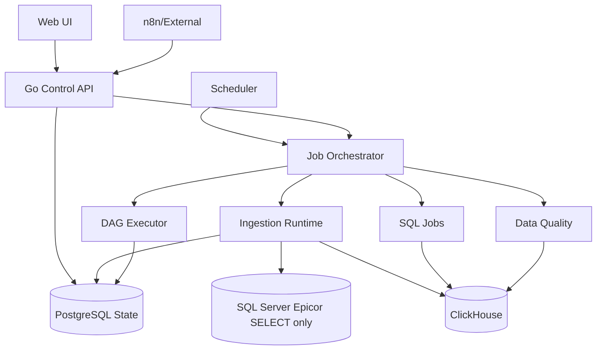

# 01 — System context and boundaries

## Control plane
REST API authorizes, validates, version-locks run definitions and returns asynchronous run IDs. Scheduler claims due triggers through PostgreSQL. Orchestrator manages leases, retries, cancellation and quotas. UI uses API only.

## Data plane
Reader performs schema-aware, parameterized keyset reads; bounded queue propagates backpressure; workers map/validate; writer stages and publishes idempotent logical results; reconciler compares complete snapshots.

## State plane
PostgreSQL stores secrets *references*, connections, immutable job revisions, runs, streams, checkpoints, leases, batch acknowledgments, schedules, audit and pipeline state. Business payloads flow directly SQL Server → ClickHouse, not through PostgreSQL.

## Security
Source SQL credentials have SELECT only. Target ingestion and SQL-transform credentials are separated and least-privileged. Log no plaintext secrets. See [deployment](../operations/security-deployment.md).
