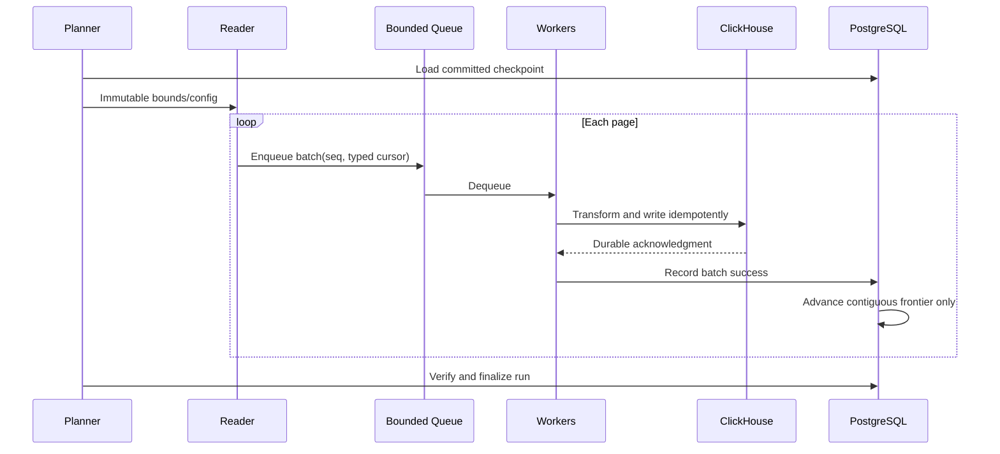

# 02 — Streaming ingestion runtime

## Performance controls
| Setting | Initial test value | Limits |
|---|---:|---|
| batch_size | 10000 | 100–100000 |
| transform_workers | 4 | 1–32 |
| write_workers | 2 | 1–16 |
| queue_capacity_batches | 10 | 1–100 |
| max_parallel_jobs | 2 | global/tenant ceiling |
| query_timeout_s | 300 | cancelable |
| write_timeout_s | 300 | bounded retries |

Expose presets and Custom; enforce bytes-in-flight quotas as well as batch counts. These values are guesses, not proven optima.

## Invariants
- Reader blocks when queue is full; goroutines must never accumulate unboundedly.
- Every batch includes run_id, stream_id, seq, bounds, count, checksum and schema hash.
- Out-of-order ACK is allowed; out-of-order checkpoint advancement is not.
- Network ACK ambiguity ⇒ replay may occur; logical dedup is required.
- Cancel stops pagination; outstanding batches follow defined drain/abort policy.
- Index and ORDER BY cost on source must be measured, never auto-create Epicor indexes.

## Fault scenarios
Crash after CH insert/before PG commit; worker 9 finishes before worker 8; source disconnect; schema drift mid-run; target overload. See [acceptance](../testing/acceptance.md).
