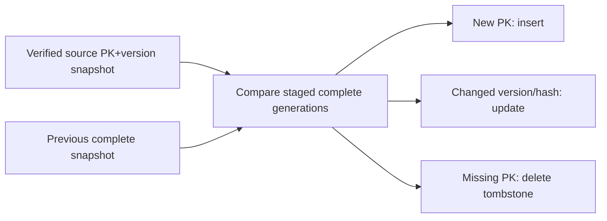

# 04 — Change detection without CDC

## A. Native rowversion polling
Read `SysRevID` as binary(8) with typed checkpoint. Detect INSERT and UPDATE of surviving current rows; no DELETE, full event history or intermediate versions. Use [safe window guidance](03-cursor-consistency.md).

## B. SQL Server Change Tracking (optional, distinct from CDC)
`CHANGETABLE(CHANGES...)` supplies changed PK and operation including DELETE; fetch current values by joining base table. Requires DBA enablement on database/table and granted permission. Validate `CHANGE_TRACKING_MIN_VALID_VERSION()` against retention; expired state means resync. No app-initiated ERP config changes.

## C. Snapshot Diff / Reconciliation

Scan source PK+version/hash in batches; stage in ClickHouse under snapshot_run_id. Never compare partial snapshots. Require stable PK and coherent snapshot; otherwise re-check suspected deletes with two passes and label best-effort. Diff creates idempotent tombstones ordered against late incremental writes; never invent a source rowversion for deletion.

## Hybrid default
Frequent rowversion polling + periodic full-key snapshot diff + explicit discrepancy/repair report. Frequency chosen by each job. Polling is near-current state, not realtime event capture.

| Property | Rowversion | SQL CT | Snapshot Diff |
|---|---|---|---|
| Source DDL changes | No | DBA required | No |
| Inserts/updates | Yes, surviving state | Yes, current state | Yes at snapshot |
| Physical delete | No | Yes | Yes |
| Event history | No | No | No |
| Source cost | Range polling | Change metadata | Full key scan |
