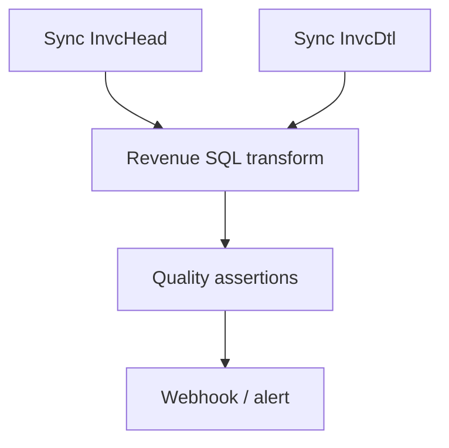

# Pipeline runtime and SQL jobs

Four job kinds: SYNC, SQL, QUALITY and PIPELINE. PIPELINE is a versioned directed acyclic graph of dependent nodes, optionally followed by a webhook.

Reject cycles. Default joins require all predecessor nodes to succeed. Track node states: pending, ready, running, succeeded, failed, skipped and cancelled. Retry and cancellation policies must be explicit. A running pipeline stores an immutable snapshot of its definition.

Cron scheduling supports time zones, due-run selection, skip/queue concurrency policy and missed-run handling. External triggers return run IDs. Postgres leases/fencing prevent concurrent ownership. SQL jobs only use appropriately privileged target credentials; never use the Epicor connection for writes. n8n is an optional external orchestrator.
