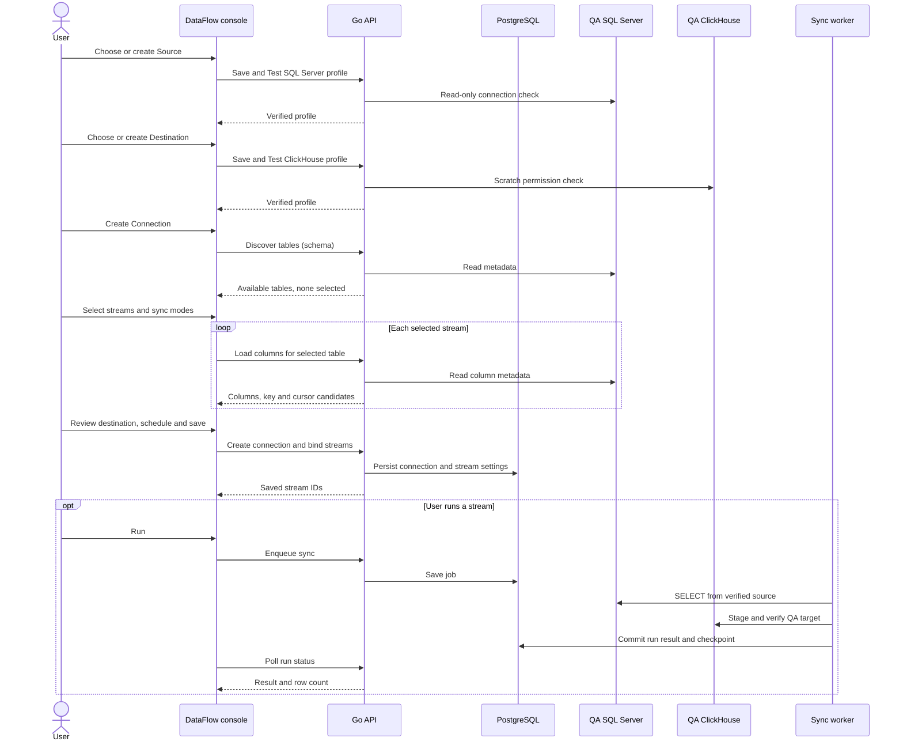

# Connection flow inspired by Airbyte

Reference inspected: `airbytehq/airbyte-platform` at `365c6ea` (27 October 2026), especially `DefineSource`, `DefineDestination`, `SyncCatalogTable`, and `ConnectionConfiguration`. This document describes DataFlow's own QA implementation and does not copy Airbyte components.

The primary route is **Sources → Destinations → Connections → Streams → Sync**. Sources and Destinations show saved profiles and their Test action. Connections shows real saved connections and leads to one creation flow. Discovery lists tables without enabling them. Selecting a table loads only its columns; search and All / Enabled / Disabled filters keep larger schemas usable. The final step reviews modes, targets, and schedule before saving.

UI references in Airbyte's source: `DefineSource` / `DefineDestination` use a choice between an existing connector and a new one, a search box, and a list of saved connectors. `SyncCatalogTable` uses a searchable, filterable table with expandable stream rows and field selection. `ConnectionConfiguration` separates stream selection from connection settings. DataFlow now follows that layout with its own light QA workspace, inline stream fields, a final review, and connection status. The implementation remains DataFlow code; no Airbyte source component or asset is copied.

This remains limited to the isolated SQL Server → ClickHouse QA path. The UI must not imply that planned connectors or production ERP operations are available.

Verification is valid for 30 minutes. When it expires, the connection shows Retest profiles; a successful Test refreshes verification without changing the profile revision, so existing bindings stay valid. Editing a profile or failing a Test invalidates its old bindings. Re-testing after that does not revive them; create a new connection for the affected streams.
