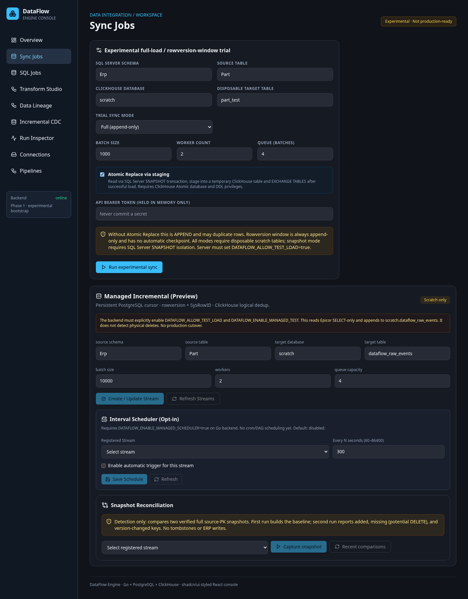
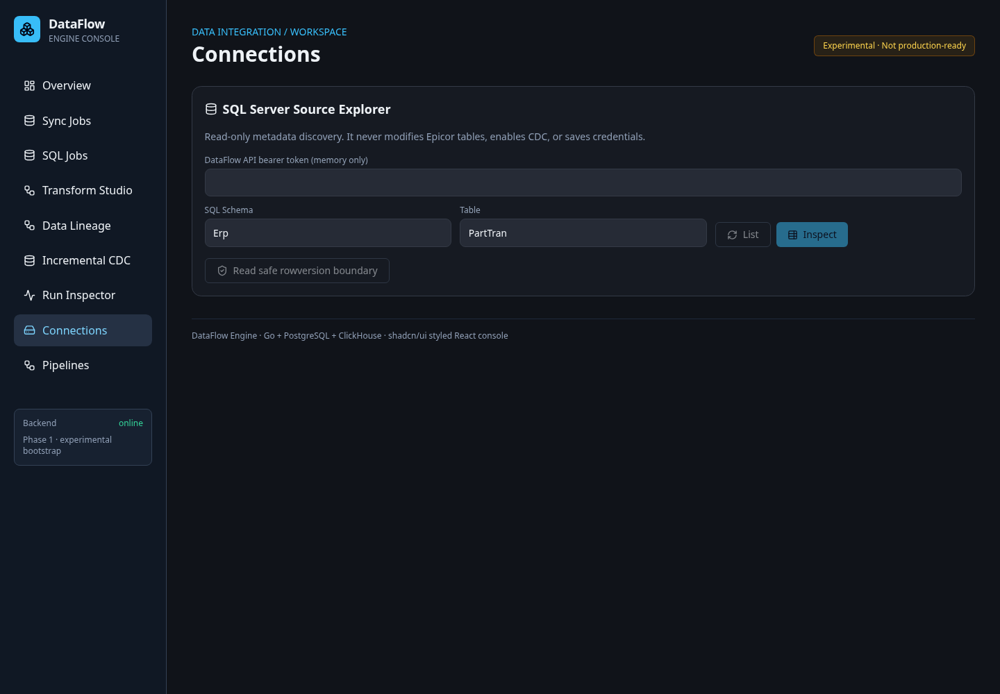
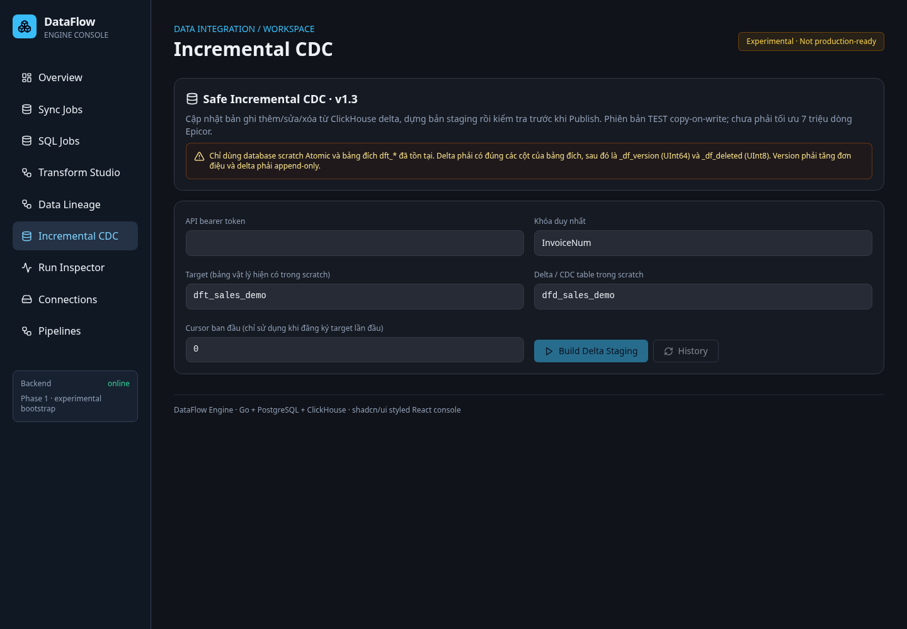

# DataFlow Engine — UI Console screenshots

Captured from the running synthetic QA Web Console on 2026-10-17. The API token fields were left empty and no credentials, production data, browser traces, or logs are included.

## Overview

## Sync Jobs

## Connections / Source Explorer

## Transform Studio

## Data Lineage

## Incremental CDC

These are visual evidence only. Functional and E2E acceptance results remain documented separately; screenshots do not replace test evidence.
